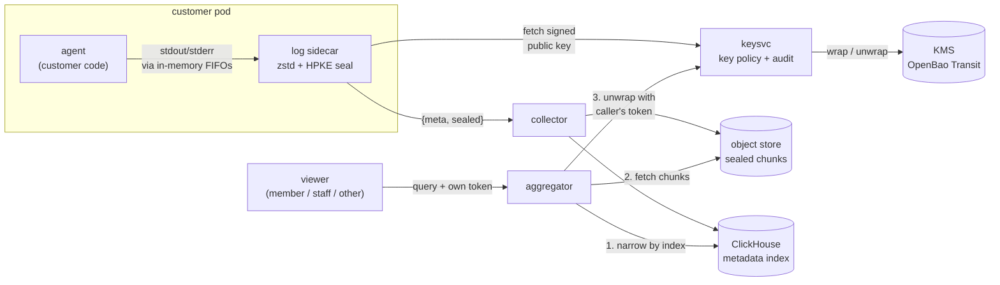

# sealed-logs

[](https://github.com/johndenverscar/sealed-logs/actions/workflows/ci.yml)

**Customer logs that the platform storing them can't read.**

If you run other people's code, you collect their logs, and their logs contain
whatever their code printed: card numbers, transcripts, API keys. This repo is a
small, working pipeline in which those logs are encrypted in the customer's pod,
stored and indexed as ciphertext, and decrypted only for members of the
customer's own project. Operator staff, other tenants and anyone who steals the
storage get ciphertext. Deleting a day's key deletes that day's logs everywhere,
backups included.

It runs on your laptop in a [kind](https://kind.sigs.k8s.io) cluster, with a
terminal UI that lets you write a log line and follow it through every
component.

> **This is a teaching prototype, not production code.** It hasn't been audited,
> and it takes deliberate shortcuts (shared demo tokens, a KMS in dev mode, no
> TLS). See [what a production version needs](docs/design.md#what-a-production-version-needs).

## What you'll learn

- **Envelope encryption** with [HPKE](https://www.rfc-editor.org/rfc/rfc9180):
  per-project, per-day key pairs, wrapped by a KMS.
- **Authenticated metadata:** how to keep an index readable without letting
  storage lie about it.
- **Access by key policy:** one small service decides who can decrypt, and audits
  every decision.
- **Crypto-shredding:** deleting data by destroying a key, and why caches make
  that harder than it sounds.
- **The gaps encryption doesn't close:** container runtimes writing stdout to
  the node's disk, and what each component still learns.

## How it works



1. The customer's code prints a line. The pod's entrypoint sends stdout and
   stderr into named pipes, so the container runtime never writes the text to
   the node's disk.
2. The sidecar groups lines into chunks, compresses each chunk and seals it to
   the project's public key for the day. It verifies keysvc's signature on that
   key first.
3. The collector accepts only `{meta, sealed}`. It stores the sealed object in
   the bucket and a metadata-only row in ClickHouse.
4. To answer a query, the aggregator narrows the chunks with the index, fetches
   them, and asks keysvc to unwrap the day keys **with the caller's token**.
   keysvc releases a key only to members of that key's project. The aggregator
   decrypts and filters in memory.
5. Purging destroys keys. The ciphertext stays where it is, and no one can read
   it again.

[docs/design.md](docs/design.md) covers each step, links to the code, and
includes the full threat model and the trade-offs.

## Quick start

Needs Docker, [kind](https://kind.sigs.k8s.io/docs/user/quick-start/#installation),
kubectl and Go 1.26. Tested on macOS and Linux.

```sh
./up.sh      # create the cluster, build, deploy, wait (about a minute once images are pulled)
./bin/tui    # the demo harness
./down.sh    # delete the cluster and everything in it
```

`up.sh` checks its prerequisites first and is safe to rerun after a code change.
Every kubectl call is pinned to `--context kind-sealed`, and `up.sh` puts your
current context back after creating the cluster.

Then follow **[the walkthrough](docs/walkthrough.md)**: eight steps, about 20
minutes, from logging a card number to purging it.

## Learning path

| | |
|---|---|
| [Walkthrough](docs/walkthrough.md) | Send a secret through the pipeline and check every place it could have leaked |
| [Design](docs/design.md) | The ideas, the threat model, the trade-offs, further reading |
| [Exercises](docs/exercises.md) | Remove one protection at a time and see which test catches it |

## Repo layout

| Path | What it is |
|---|---|
| [`internal/envelope`](internal/envelope/envelope.go) | Chunk format: zstd, HPKE seal and open, metadata bound as AAD |
| [`cmd/keysvc`](cmd/keysvc/main.go) | Day keys, KMS wrapping, signed public keys, the unwrap policy, purge, retention, audit |
| [`cmd/producer`](cmd/producer/main.go) | The log sidecar, the fake customer agent, an in-process SDK and a plaintext-sending "old client" |
| [`cmd/collector`](cmd/collector/main.go) | Validates and stores sealed chunks, writes the metadata index |
| [`cmd/aggregator`](cmd/aggregator/main.go) | Query path: index, fetch, unwrap as the caller, decrypt, search |
| [`internal/wrap`](internal/wrap/wrap.go) | `KeyWrapper` interface and the OpenBao Transit implementation |
| [`internal/auth`](internal/auth/auth.go) | Demo tokens: member, staff, producer |
| [`cmd/tui`](cmd/tui/main.go) | The harness. It follows services' JSON events through `kubectl logs` and reads the stores live |
| [`cmd/logs`](cmd/logs/main.go) | CLI viewer: query, scan raw storage, purge |
| [`deploy/`](deploy/) | Kubernetes manifests (kustomize) and the kind config |

| Workload | Stands in for |
|---|---|
| `agent` pod: `agent` + `log-sidecar` containers | a customer workload on a hosting platform, with a log-shipping sidecar |
| `collector`, `aggregator` | the log ingest and query services |
| `keysvc` | a key service (SQLite on a volume here) |
| `clickhouse` | the log index |
| `objectstore` (SeaweedFS) | any S3-compatible object store |
| `openbao` | any KMS, behind the `KeyWrapper` interface |

Host ports, all on 127.0.0.1: 7101 keysvc, 7102 collector, 7103 aggregator,
7104 agent (`POST /log`), 18123 ClickHouse HTTP, 19100 object store.

## Other ways in

```sh
./bin/logs --as member --q 4111      # digit searches also match through separators
./bin/logs --as staff                # ciphertext only
./bin/logs --scan                    # what someone with the bucket and ClickHouse sees
./bin/logs --purge $(date -u +%F)
open 'http://127.0.0.1:18123/play?user=sealed&password=sealed'   # ClickHouse SQL UI
SEED=1 ./up.sh                       # also write three past days of logs
CHATTER=1 ./up.sh                    # make the fake agent log on its own
```

## Tests

```sh
go test ./...                                 # unit tests, no cluster needed
SEALED_LIVE=1 go test ./cmd/tui -v -count=1   # end to end against the running cluster
```

The unit tests check the security properties directly: tampering is detected, the
wrong key fails, staff and other tenants are refused, purge publishes a
revocation, and the collector refuses plaintext. CI runs these plus the end-to-end
suite on kind, and checks the node's disk for leaked plaintext.

## License

[MIT](LICENSE)
