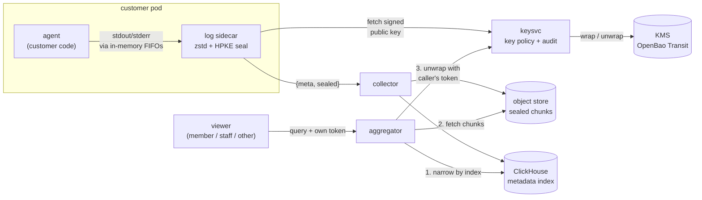

# sealed-logs

A very basic implementation of log encryption for customer platforms.

- Logs are encrypted inside the customer's pod, before they go anywhere.
- Storage only ever holds ciphertext, plus a bit of metadata so queries stay fast.
- People in the customer's project can read their logs. Operator staff and other
  customers get ciphertext.
- Deleting a day's key deletes that day's logs everywhere, backups included.

It runs on your laptop in a [kind](https://kind.sigs.k8s.io) cluster and comes
with a web page where you type a log line and watch it move through each
component, plus a customer-style log viewer to read it back. [The demo](docs/demo.md) walks you through it

> This is a demo, not production code. Nobody has audited it, and it cuts some
> corners on purpose: shared demo tokens, a KMS in dev mode, no TLS. The
> [design doc](docs/design.md#what-a-production-version-needs) lists what a real
> version would need.

## Architecture



Here's the trip a log line takes.

1. The customer's code prints it. The pod's entrypoint points stdout and stderr
   at named pipes instead of the container runtime, so the line never lands on
   the node's disk.
2. The log sidecar reads the pipes, batches lines into chunks, compresses each
   chunk and encrypts it to the project's public key for the day. Before it
   trusts that key, it checks keysvc's signature on it.
3. The collector stores the encrypted chunk in the bucket and writes a row of
   metadata (project, session, time range, how many errors) to ClickHouse. It
   turns away anything that isn't encrypted.
4. When someone queries, the aggregator uses the index to find the right chunks,
   fetches them, and asks keysvc to unwrap that day's key using *the caller's*
   token. keysvc only says yes to members of the key's project. The aggregator
   then decrypts and searches in memory.
5. Purging a day destroys its key. The ciphertext stays exactly where it is, and
   nobody can read it again.

| Component | Code | What it stands in for |
|---|---|---|
| `agent` pod: `agent` + `log-sidecar` | [`cmd/producer`](cmd/producer/main.go) | Customer code running on a hosting platform, next to a log-shipping sidecar |
| `collector` | [`cmd/collector`](cmd/collector/main.go) | The log ingest service |
| `aggregator` | [`cmd/aggregator`](cmd/aggregator/main.go) | The log query service |
| `keysvc` | [`cmd/keysvc`](cmd/keysvc/main.go) | A key service: day keys, signed public keys, the unwrap policy, purge, retention, audit |
| `clickhouse` | | The metadata index |
| `objectstore` (SeaweedFS) | | Any S3-compatible object store |
| `openbao` | [`internal/wrap`](internal/wrap/wrap.go) | Any KMS, behind a small `KeyWrapper` interface |

The chunk format (compression, encryption and the authenticated metadata) lives
in [`internal/envelope`](internal/envelope/envelope.go). The web demo is
[`cmd/demo`](cmd/demo/main.go), there's a plain CLI in [`cmd/logs`](cmd/logs/main.go),
and the Kubernetes manifests are in [`deploy/`](deploy/).

[docs/design.md](docs/design.md) goes through each piece and why it's there,
along with the threat model and the trade-offs. [docs/break-it.md](docs/break-it.md)
has six one-line changes that each remove a protection, and the test that
catches each one.

## How to run it

You'll need Docker, [kind](https://kind.sigs.k8s.io/docs/user/quick-start/#installation),
kubectl and Go 1.26. I've run it on macOS and Linux.

```sh
./up.sh      # create the cluster, build, deploy and wait (about a minute once images are pulled)
./bin/demo   # the web demo, on http://127.0.0.1:7100
./down.sh    # delete the cluster and everything in it
```

`up.sh` checks that you have everything before it starts, and you can rerun it
after changing code. It won't touch your other clusters: every kubectl call uses
`--context kind-sealed`, and it switches your current context back after
creating the cluster.

Once it's up, follow [the demo](docs/demo.md).

There's also a CLI if you'd rather stay in the terminal:

```sh
./bin/logs --as member --q 4111      # search; digits match through separators too
./bin/logs --as staff                # staff only get ciphertext
./bin/logs --scan                    # what someone with the bucket and ClickHouse would see
./bin/logs --purge $(date -u +%F)    # destroy today's key
open 'http://127.0.0.1:18123/play?user=sealed&password=sealed'   # ClickHouse's SQL UI
SEED=1 ./up.sh                       # also write three past days of logs
CHATTER=1 ./up.sh                    # have the fake agent log on its own
```

Everything listens on 127.0.0.1: keysvc on 7101, the collector on 7102, the
aggregator on 7103, the agent on 7104 (`POST /log`), ClickHouse on 18123 and the
object store on 19100.

To run the tests:

```sh
go test ./...                                 # unit tests, no cluster needed
SEALED_LIVE=1 go test ./cmd/demo -v -count=1  # end to end, against the running cluster
```

The unit tests go straight at the security properties: tampering is caught, the
wrong key fails, staff and other tenants are refused, a purge is announced to the
aggregator, and the collector refuses plaintext. CI runs those, then brings up
the whole stack on kind, runs the end-to-end tests and checks the node's disk
for the test card number.

## License

[MIT](LICENSE)
